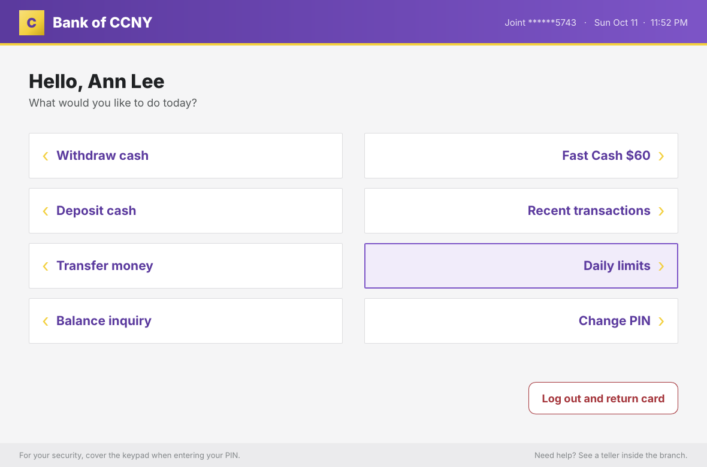
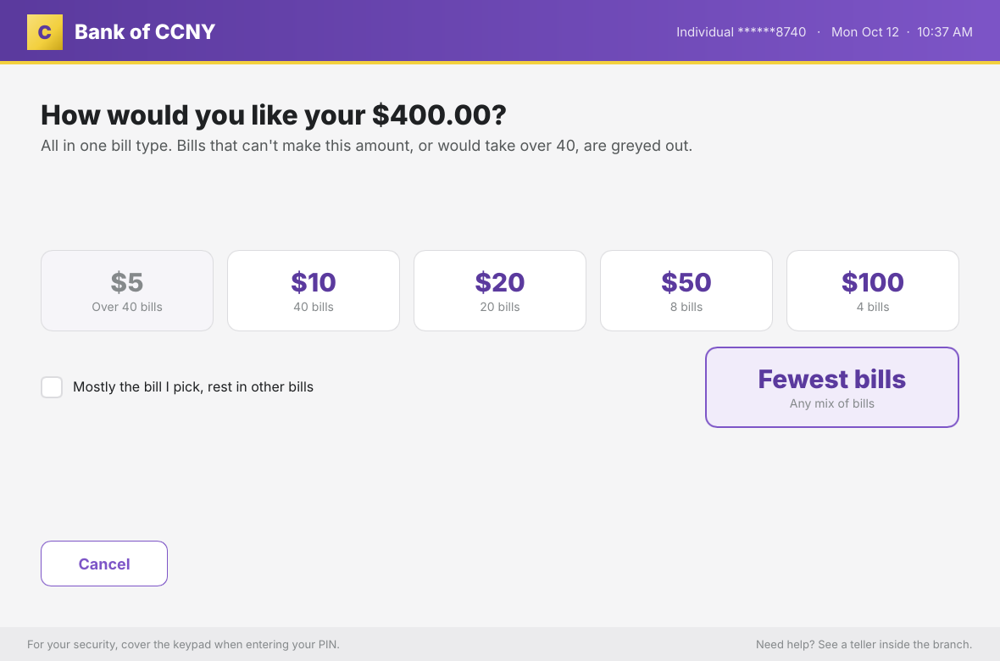
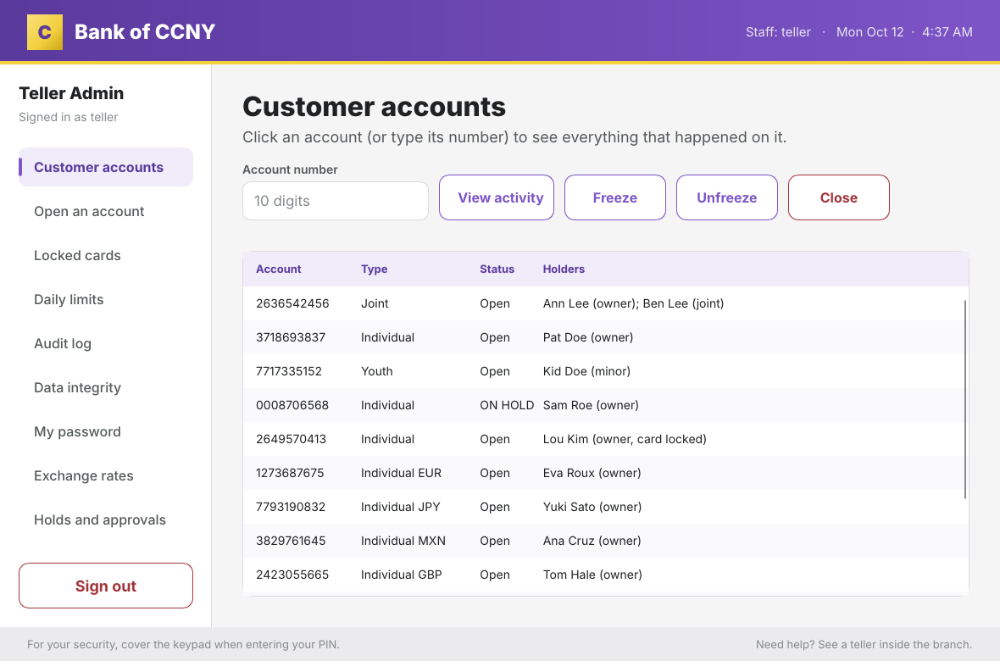
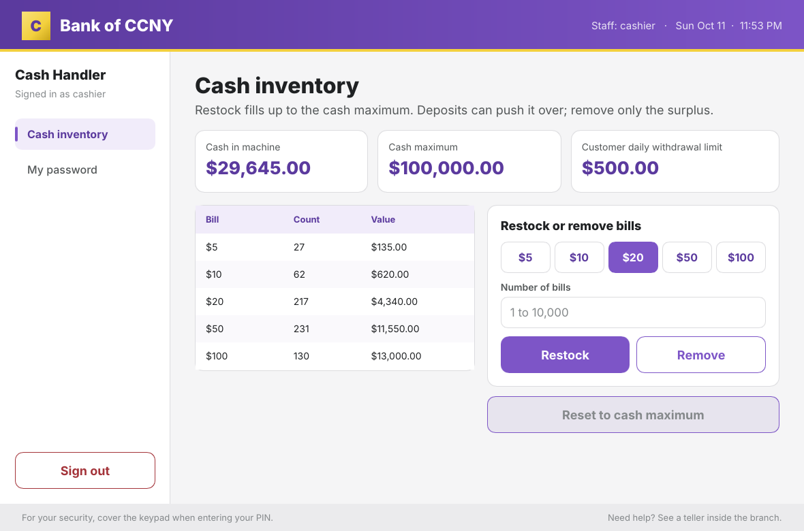

# Bank of CCNY ATM

A secure ATM simulation written in Rust for three kinds of users:
**Customers**, **Teller Admins** and **Cash Handlers**. It has a desktop GUI
(Slint) and a command-line version. Both are thin front ends over one library
(`src/`) that enforces every rule. All data is stored in SQLite.

<p align="center">
  
  
</p>
<p align="center">
  
  
</p>

## Quick start

```
cargo run --profile quick -p atm-gui --features demo -- --demo
```

This builds and starts the GUI with sample data. The first run compiles
everything (a few minutes); later runs start at once. `--profile quick`
compiles about a third faster than `--release` by optimizing only the
crypto; the screens look and respond the same.

The demo logins and PINs are in [docs/USER_GUIDE.md](docs/USER_GUIDE.md#demo-logins).

---

## 1. Install

| You need | How |
|---|---|
| Rust 1.92 or newer | [rustup.rs](https://rustup.rs); if already installed, `rustup update` |
| A C compiler (SQLite is built in) | macOS: `xcode-select --install` · Ubuntu/Debian: `sudo apt install build-essential` · Windows: Visual Studio Build Tools, "Desktop development with C++" |
| Linux only, for the GUI | `sudo apt install libfontconfig1-dev` |

Then, in this folder:

```
cargo build --release --workspace
```

The first build compiles the GUI toolkit: a few minutes on a recent laptop,
about 7 on a 4-core test machine. Later
builds take seconds. The command line alone (`cargo build --release`) takes
about 1 minute. For a demo, the Quick start command above is the whole
install: it builds only what the demo needs, with the faster `quick`
settings.

Cargo downloads the libraries listed in `Cargo.lock` the first time. On a
machine with no internet, run `cargo fetch` beforehand on one that has it.

## 2. Run

| | Command |
|---|---|
| GUI | `cargo run --release -p atm-gui` |
| Command line | `cargo run --release` |
| GUI with sample data | `cargo run --profile quick -p atm-gui --features demo -- --demo` |
| Command line with sample data | `cargo run --release --features demo -- --demo` |

**A real bank (no `--demo`)** starts empty. On first run the program asks you
to create the Teller Admin and Cash Handler logins (usernames 3-32 of a-z,
0-9 and `_`; passwords 12+ characters, typed twice). Then:

1. **Cash Handler:** restock some bills (the machine starts empty).
2. **Teller Admin:** open an account. Note the **card number** (to sign in)
   and the **account number** (to receive transfers).
3. **Customer:** tap the card on the welcome screen, then type the card number and the PIN.

A bank is three files in the folder you run from: `atm.db` (data), `atm.key`
(secret key) and `atm.anchor` (the newest seal). Keep them together. The
program refuses to start if the key is missing or wrong, if the database was
edited outside the ATM, or if it is an older copy than the anchor remembers.
To start over on purpose, delete all three.

**Demo mode** uses its own files (`atm-demo.db`, `.key`, `.anchor`) filled
with a Teller Admin, a Cash Handler, 10 sample card holders (joint, youth,
locked card, cards from other banks in four currencies), sample exchange
rates and random cash. The welcome screen shows a **demo wallet**: click a
card to insert it and type its PIN, or click a staff badge to fill in the
staff ID. In the teller's forms, a **Choose** button next to each card or
account field fills in a sample customer's number, so nothing long has to be
typed. Card and account numbers are never shown in full. Delete `atm-demo.*`
for a fresh demo bank. Sample rates expire after 72 hours; press **Check
today's rates** as the Teller Admin, or start a fresh demo bank.

Demo mode only exists when built with `--features demo`. The normal build has
no built-in passwords, and demo data can't be opened as a real bank.

**Integrity test.** To see the ATM take itself out of service:

```
cargo run --release -p atm-gui --features integrity-test -- --demo --break-integrity
```

This builds sample data in `atm-test.*`, then adds $500 to Ann and Ben's
balance without a log entry, as someone editing the records would. Sign in as
the Teller Admin: the check fails, names the account, and the ATM goes out of
service until the teller resumes it. Delete `atm-test.*` to run it again.

**Network:** only the Teller Admin's **Check today's rates** button goes
online. Nothing listens on a network port.

## 3. Test

```
cargo test                   # 155 tests + 5 compile-fail checks
cargo test --features demo   # adds the sample-data tests
```

The compile-fail checks prove a front end can't skip a security rule: that
code must fail to build. [docs/TEST_PLAN.md](docs/TEST_PLAN.md) lists what to
try by hand.

## 4. What it does

- **Customers** sign in with card number and PIN. They can check balance and
  daily limits, withdraw ($5 to $100 bills, one type or mixed, at most 40
  bills), deposit, transfer by account number (with **Send again** for the
  last 5 payees), see history and change their PIN. The ATM asks about a
  receipt first and returns the card before the cash.
- **Daily limits:** $1,000 cash out, $10,000 cash in, $5,000 transfers. A
  teller can approve more for one account for today.
- **Unusual activity** (rapid withdrawals, many new payees, emptying the
  account) puts a hold on the account until a teller releases it.
- **Joint and youth accounts** (the additional feature). Guardians get a
  **Family** screen with caps, a freeze button and money moves.
- **Cards from other banks** can withdraw and check balance, pay an ATM fee
  and, if in another currency, are converted at the day's rate plus a fee.
  Bank of CCNY accounts are always in US dollars.
- **Teller Admins** open accounts, unlock cards, freeze or close accounts,
  set limits and fees, approve rates, release holds, view the signed log and
  run the integrity check. Each Teller sign-in runs that check; if it fails,
  the ATM goes out of service.
- **Cash Handlers** see, restock and remove cash, up to $100,000.

Every feature, with the matching rubric line, is in
[docs/FEATURES_AND_SECURITY_CHECKLIST.md](docs/FEATURES_AND_SECURITY_CHECKLIST.md).

**Security in brief.** No default passwords. PINs and passwords are Argon2id
hashes keyed with a secret from `atm.key`. Names, birth dates and card and
account numbers are AES-256-GCM encrypted. Every action goes into an
HMAC-chained audit log in the same transaction as the money. The whole
database is sealed with an HMAC checked before every operation, and
`atm.anchor` refuses an older copy. 3 wrong PINs lock a card; sessions end
after 2 minutes idle. The front ends can't run SQL or skip a check: the
compiler stops them. See [docs/THREAT_MODEL.md](docs/THREAT_MODEL.md) (STRIDE)
and [docs/VULNERABILITIES.md](docs/VULNERABILITIES.md).

## 5. Where things are

```
src/              the secure core library (crate `atm`) + the command-line front end
  lib.rs            Atm::open, module list, compile-fail proofs of the trust boundary
  error.rs          one error type; the only text users ever see
  money.rs          Cents and bill types (no negatives, no floats, checked math)
  input.rs          validators (names, dates, PINs, passwords) + CLI keyboard input
  keys.rs           atm.key: PIN pepper, log MAC key, field encryption, number lookup
  db.rs             SQLite tables (STRICT), CHECK constraints, append-only triggers
  seal.rs           one HMAC over the whole database, checked before every operation
  anchor.rs         atm.anchor: the newest seal, so an older atm.db is refused
  audit.rs          HMAC-chained log, daily totals, integrity check
  auth.rs           logins, lockout, idle timeout, logout, session types
  dispense.rs       which bills to pay out
  fx.rs             currencies, exchange rates, fees, charge summary
  rate_feed.rs      today's rates: HTTPS fetch, strict read, check, approve
  review.rs         suspicious-activity holds
  service.rs        out of service: check at teller sign-in, halt, resume
  customer.rs       customer actions         (need a CustomerSession)
  family.rs         guardian controls        (need a CustomerSession + guardian link)
  admin.rs          Teller Admin actions     (need an AdminSession)
  cash.rs           Cash Handler actions     (need a HandlerSession)
  demo.rs           sample data (demo builds only)
  main.rs, ui.rs    command-line menus
gui/              the desktop GUI (crate `atm-gui`)
  ui/*.slint        screens; bank.slint lists every property and action
  src/main.rs       start-up, idle timer, shared helpers
  src/customer.rs   customer and family screens
  src/staff.rs      setup, Teller Admin and Cash Handler consoles
  src/wallet.rs     demo wallet (demo builds only)
tests/            attacks.rs, review.rs, audit.rs, demo_mode.rs
CHANGES.md        what changed in each version, function by function
docs/
  USER_GUIDE.md                      every screen step by step, demo logins
  STUDY_GUIDE.md                     the project by rubric line, for the demo and oral exam
  THREAT_MODEL.md                    assets, STRIDE, defenses, assumptions
  VULNERABILITIES.md                 every attack considered, its defense and status
  COURSE_MAPPING.md                  where each security choice comes from in the course
  FEATURES_AND_SECURITY_CHECKLIST.md feature list by rubric line
  TEST_PLAN.md                       what to test by hand
  DESIGN_DECISIONS.md                why each design choice was made
```

Comments starting `STRIDE (...)` mark the code that defends against that
threat.

**How a front end talks to the core.** It gets an `Atm` from `Atm::open` and
a session from a login (`auth::login_customer`, `login_admin`,
`login_handler`). Every action is a function in `customer`, `family`,
`admin`, `cash`, `review`, `service` or `fx` that takes that session. A front
end never gets a database connection. Errors are `AtmError`, whose text is
always safe to show.

## 6. Before submitting

Run `cargo clean`, then zip the folder **without** `target/`, `atm.*`,
`atm-demo.*` or `atm-test.*`. Keep `Cargo.lock`.
