# Bank of CCNY ATM: User Guide

This guide walks through every screen of the ATM, step by step, for each of
the three kinds of users. You don't need to know any code to follow it.

- [1. Before you start](#1-before-you-start)
- [2. Using the screens](#2-using-the-screens)
- [3. Customers](#3-customers)
- [4. Teller Admin](#4-teller-admin)
- [5. Cash Handler](#5-cash-handler)
- [6. Command-line version](#6-command-line-version)
- [7. Messages you may see](#7-messages-you-may-see)

---

## 1. Before you start

**Install** the program as described in the [README](../README.md#1-install)
(section 1). Then open a terminal in the project folder (the one with
`Cargo.toml`) and start the ATM:

| To run | Type |
|---|---|
| The ATM with your own data | `cargo run --release -p atm-gui` |
| The ATM with sample data (for practice) | `cargo run --release -p atm-gui --features demo -- --demo` |

### First run: create the staff logins

The first time the ATM starts with its own data, it shows **FIRST-TIME
SETUP**. The machine has no built-in passwords, so you create them now:

1. Type a **Teller Admin username** and a **Cash Handler username**: 3 to 32
   characters, using only a-z, 0-9 and `_`.
2. Type a **Password** for each (12 characters or more), and type it again.
3. Click **Create logins**.

Then, before customers can use the machine:

1. The **Cash Handler** restocks some bills ([section 5](#5-cash-handler)). The
   machine starts empty.
2. The **Teller Admin** opens an account for each customer
   ([section 4.2](#42-open-an-account)) and gives them their card number.
3. For other banks' cards in another currency, the Teller Admin sets today's
   exchange rates ([section 4.7](#47-exchange-rates-and-fees)).

The ATM keeps its data in three files in this folder: `atm.db` (the data),
`atm.key` (the secret key) and `atm.anchor` (a short note of the newest
version of the data, so an older copy of `atm.db` can't be put back). Keep
them together: the ATM won't open if one of them is missing. To start over,
close the ATM and delete all three.

### If the ATM won't start

When something is wrong with these files, the ATM doesn't open. It prints one
line in the terminal and stops, without changing anything. The full messages
are in [section 7](#7-messages-you-may-see).

| What happened | The message says | What to do |
|---|---|---|
| `atm.db` was deleted or moved, but `atm.key` or `atm.anchor` is still there | "the bank's database file is missing" | Put `atm.db` back. Deleting the data file never brings back FIRST-TIME SETUP. To start a new, empty bank on purpose, delete all three files. |
| `atm.key` is missing, broken or from another bank | "the key file is missing" / "is damaged" / "does not belong to this database" | Put the right `atm.key` back |
| `atm.anchor` is missing or was edited | "the anchor file is missing" / "has been altered" | Put the right `atm.anchor` back |
| `atm.db` was changed by another program | "TAMPERING DETECTED" | Stop and escalate |
| An older copy of `atm.db` was put back | "DATABASE ROLLED BACK" | Stop and escalate. Only the newest copy opens. |
| The files come from an older version of the ATM | "made by a different version" | Delete all three files and start over |
| Practice data was copied over `atm.db` | "this is a demo database with published passwords" | Use the real bank's files. Practice data runs only in practice mode. |
| The computer's clock is earlier than the newest log entry | "System clock is behind the audit log" | Fix the clock |

### Practice mode (sample data)

With `--demo`, the ATM uses separate files (`atm-demo.db`, `atm-demo.key`,
`atm-demo.anchor`) filled with sample customers, staff logins, exchange rates
and cash. The welcome screen shows a **demo wallet**: click a card to insert
it, then type its PIN from the table below. Click a staff badge to fill in the
staff ID, then type the password. Cards show only their last 4 digits. In the
teller's forms, the **Choose** button next to a card or account field fills in
that customer's full number, as if they had handed over their card. To reset
the practice bank, close the ATM and delete `atm-demo.*`.

#### Demo logins

| Who | PIN or password | Try |
|---|---|---|
| Teller Admin `teller` | `teller-demo-2026` | everything in [4](#4-teller-admin) |
| Cash Handler `cashier` | `cashier-demo-2026` | restock, remove cash |
| Ann Lee (joint with Ben) | 4821 | withdraw, deposit, transfer |
| Ben Lee (joint with Ann) | 7305 | same account as Ann, own card |
| Pat Doe (guardian of Kid) | 1357 | **Family** screen |
| Kid Doe (youth account) | 2580 | caps set by Pat |
| Sam Roe (individual) | 9512 | transfer, **Send again** |
| Lou Kim (card locked) | 8642 | unlock in [4.4](#44-locked-cards) |
| Ray Park (other bank, USD) | 2468 | ATM fee |
| Eva Roux (other bank, EUR) | 3691 | conversion at today's rate |
| Yuki Sato (other bank, JPY) | 5274 | conversion, whole yen |
| Luis Pena (other bank, DOP) | 3579 | conversion |

These logins exist only in practice mode. A normal build has no built-in
passwords, and practice data never opens as a real bank.

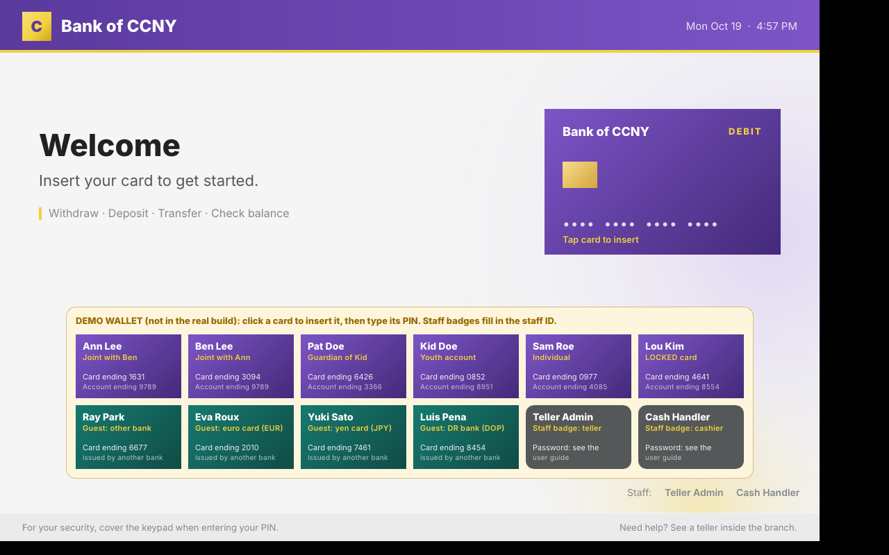

### Integrity test (test builds only)

To see the out-of-service mode ([4.1](#41-sign-in-and-out)) working, a test
build can break the practice data on purpose:

| To run | Type |
|---|---|
| The screens | `cargo run --release -p atm-gui --features integrity-test -- --demo --break-integrity` |
| The command line | `cargo run --release --features integrity-test -- --demo --break-integrity` |

It uses its own files (`atm-test.db`, `atm-test.key`, `atm-test.anchor`), so
the normal practice bank is never spoiled. At start it adds $500 to Ann and
Ben's balance with no log entry, and says so in the terminal. The next Teller
Admin sign-in finds the mismatch: the red banner names the account by its
last 4 digits with both amounts, and the start screen takes no cards. Each start with `--break-integrity` adds another $500; delete
`atm-test.*` to start clean. Normal and practice builds don't have this
option.

---

## 2. Using the screens

- **Keypad screens** (card number, PIN, amounts) also take the keyboard:
  digits, **Enter**, **Backspace** and **Esc** (cancel). **Clear** empties the
  box.
- **Card numbers, account numbers and PINs** are never shown in full: a card
  shows only its last 4 digits, and a PIN shows as dots. (The demo wallet in
  practice mode is the exception.)
- **Timeouts.** After 90 seconds without a tap the ATM asks **"Do you need
  more time?"**: click **Yes, continue** or **End session**. After 2 minutes it
  signs you out. A half-typed card number or PIN is cleared after 60 seconds.
- **Cancel** on any screen goes back without changing anything.
- **Signing out** (or a timeout) wipes every screen: the next person sees
  nothing of the last one's name, balance, receipt or results.
- **PIN and password boxes** on the staff screens can't be copied from (copy,
  cut and select-all do nothing, and the mouse can't select in them). Tab
  moves between boxes as usual.

---

## 3. Customers

### 3.1 Insert your card and sign in

1. On the welcome screen, click the card (**Tap card to insert**). In practice
   mode, click a card in the demo wallet instead and skip to step 3.
2. Type your 10-digit **card number** and press **Enter**. Only the last 4
   digits show.
3. Type your **PIN** and press **Enter**.

You see the menu, with your name and the last 4 digits of your account at the
top.

- A wrong card number and a wrong PIN give the same message, so nobody can
  find out which cards exist. A made-up card number even says "card locked"
  after 3 tries, just like a real card.
- **3 wrong PINs in a row lock the card.** A wrong PIN typed at the teller's
  counter ([4.2](#42-open-an-account)) counts too. A locked card can only be
  unlocked by a teller inside the branch, after checking photo ID, and at most
  once a day.

**Out of service.** If the welcome screen says **Out of service** ("This ATM
is temporarily out of service. Please use another ATM."), the ATM has been
taken out of service ([4.1](#41-sign-in-and-out)). The card is grayed out and
can't be inserted, so nothing is typed and nothing happens to your account:
use another ATM, or come back later. If it happens while you are signed in,
your session ends and the welcome screen shows the message. The screen checks
every few seconds, so it comes back by itself when a teller resumes service.

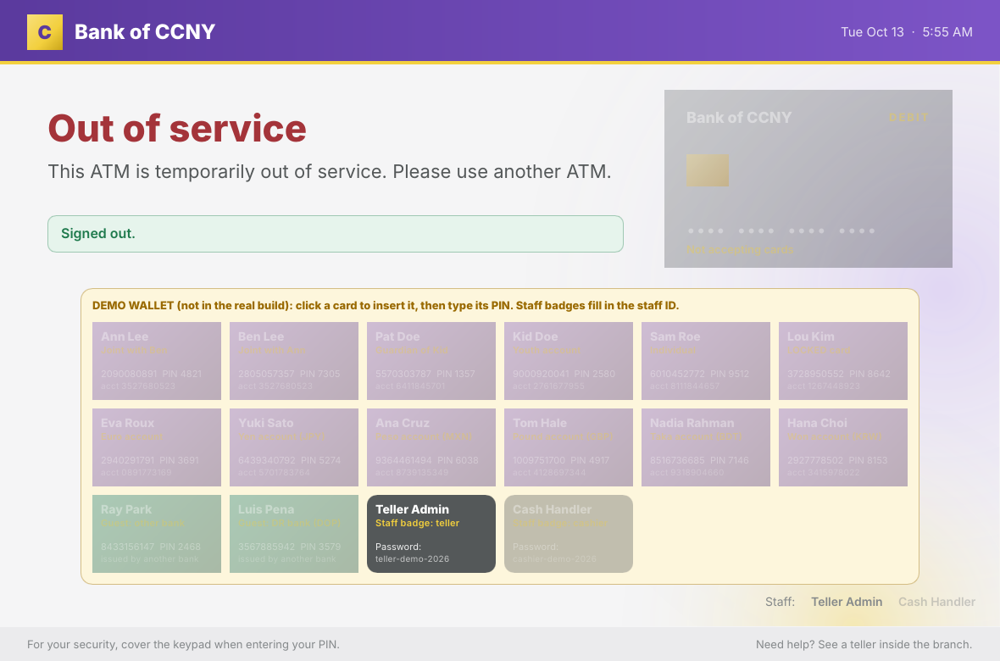

**Frozen by the bank.** If the screen says **"This account is frozen by the
bank. Please see a teller inside the branch."**, a teller froze the account
(for example after a card was reported stolen). The card is returned and
can't be used for anything until a teller lifts the freeze. A freeze set by a
parent on a youth account is different: the card still works, but no money
can leave the account ([3.10](#310-family-accounts-parents-and-guardians)).

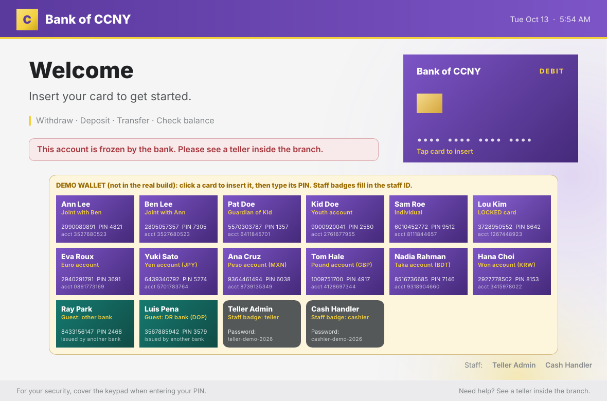

### 3.2 Withdraw cash

1. Click **Withdraw cash**.
2. Pick an amount ($20 to $400), or **Other amount** and type whole dollars
   in multiples of $5, then **Enter**.
3. Choose your bills:
   - **Tap one bill type** to get everything in that bill ($5, $10, $20, $50
     or $100). Each tile shows how many bills that would be. A tile is greyed
     out if that bill can't make the amount exactly, or would take more than
     40 bills (the most the machine pays at once).
   - Tick **Mostly the bill I pick, rest in other bills** first to get as many
     of your bill as possible and the rest in other bills.
   - Or tap **Fewest bills** for any mix.

   If the machine is short of the bill you picked, it says so and lists the
   bills it can use for that amount. Pick one of those, or **Fewest bills**.

   

4. The confirmation shows the bills and adds up the charge: the withdrawal,
   each fee, the total and, for a card in another currency, the amount
   **charged to your account**. Small print says how each fee is worked out
   (for example "3% of the amount, $3.00 minimum") and gives the rate. Click
   **Confirm**, or **Cancel**.

   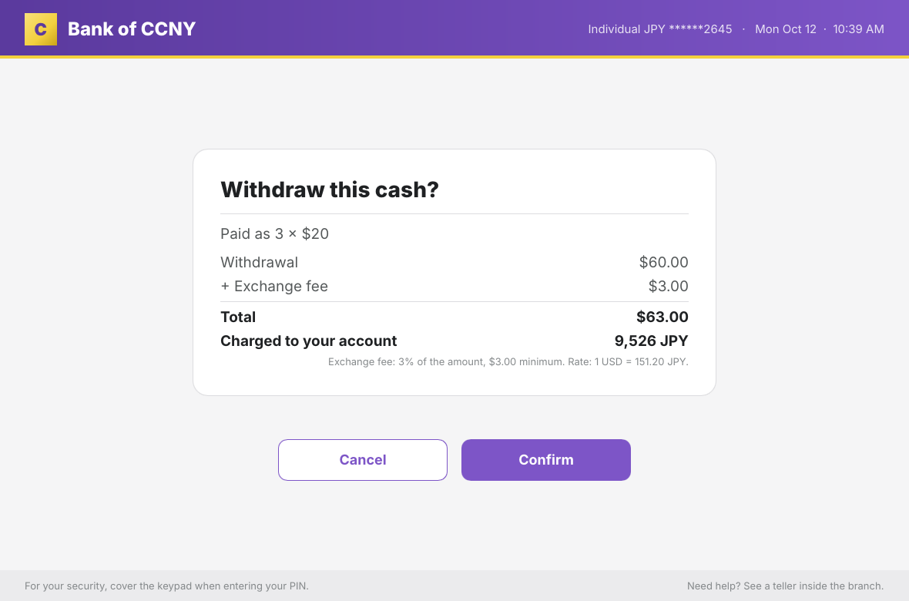

5. **Would you like a receipt?** Click **Yes, print one** or **No receipt**
   (or **Cancel** to stop; nothing has happened yet).

   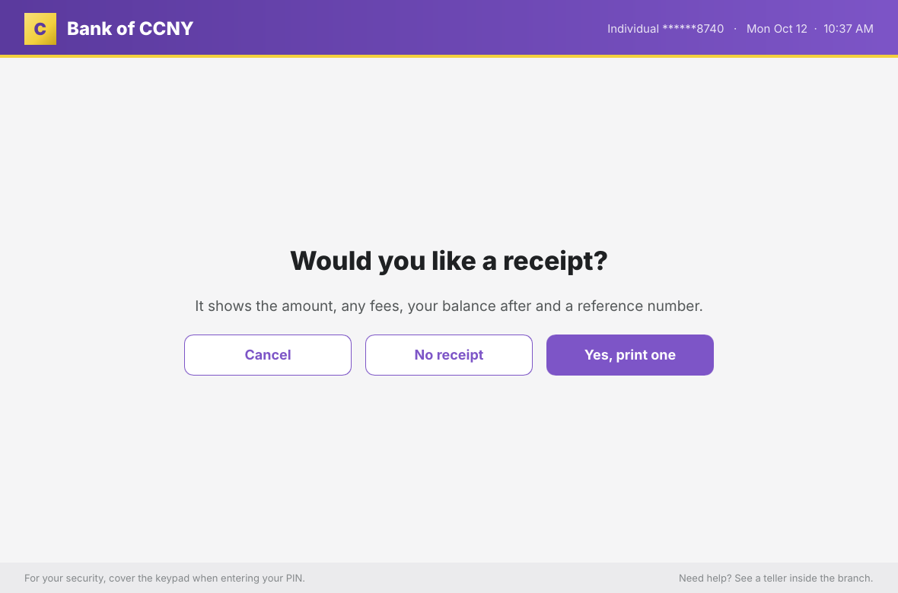

6. **Please take your card.** Click the card. Your session ends here: the card
   always comes back before the cash, because people who already have their
   money tend to walk away without the card.

   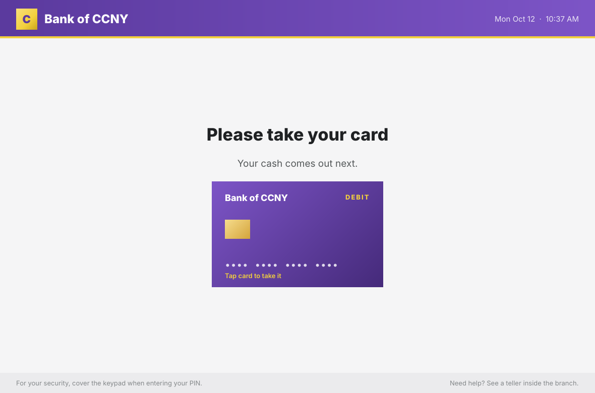

7. **Please take your cash.** The screen shows the bills (for example
   "3 × $20"). Click the cash.

   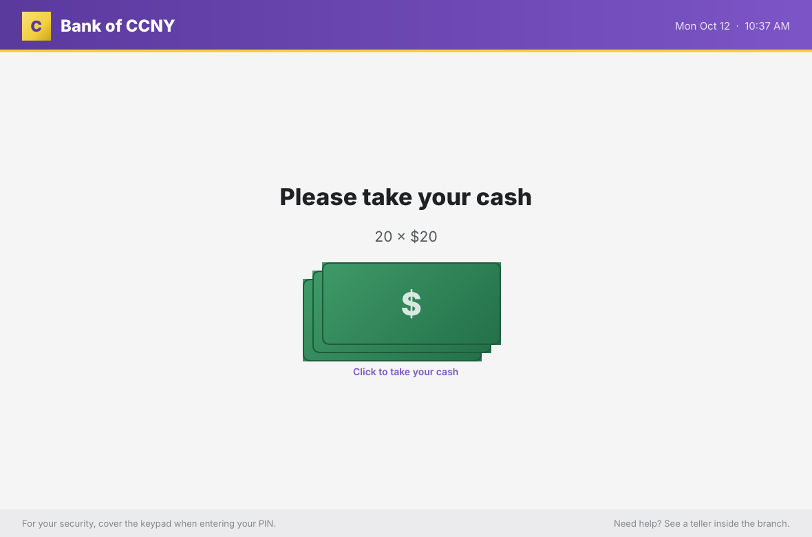

8. If you asked for a receipt, it shows the charge, the bills, your balance
   after and a receipt number with the time. Click **Done**.

To do something else, insert your card again.

### 3.3 Fast Cash $60

Click **Fast Cash $60** on the menu for $60 in $20 bills. It goes straight to
the confirmation, then continues as in [3.2](#32-withdraw-cash) from step 4.

### 3.4 Deposit cash

1. Click **Deposit cash**.
2. Tap the bill you are putting in, type **how many**, and press **Enter**.
3. On the confirmation, click **Add other bills** to add another bill type, or
   **Confirm**.
4. Choose **Yes, print one** or **No receipt**.
5. The result shows the deposit. Click **Another transaction** or **Log out**.

### 3.5 Transfer money

1. Click **Transfer money**.
2. Either tap an account under **Send again** (the last 5 accounts you paid,
   shown by their last 4 digits and the holders' initials), or type the
   10-digit **account number** and press **Enter**. The holders' initials
   appear so you can check it's the right account.
3. Type the amount in cents-first style: $25.00 is `2500`. (Yen and won have
   no cents, so `2500` is 2,500.) Press **Enter**.
4. Check the confirmation and click **Confirm**.
5. Choose **Yes, print one** or **No receipt**, then **Another transaction**
   or **Log out**.

3 unknown account numbers in one
session end the session.

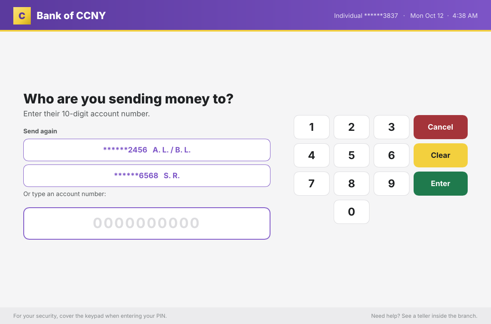

### 3.6 Balance inquiry

Click **Balance inquiry**. It shows your balance, the account type and
whether the account is frozen. For another bank's card it also shows the ATM
fee and, for a card in another currency, today's rate.

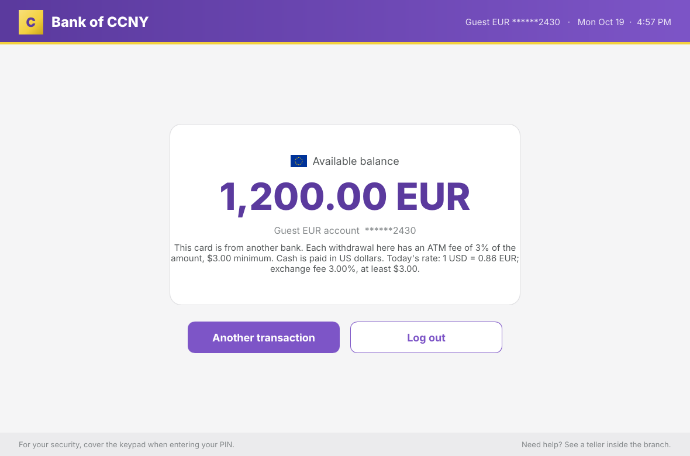

### 3.7 Recent transactions

Click **Recent transactions**: 10 per page, newest first. Use **Newer** and
**Older** to page through.

### 3.8 Daily limits

Click **Daily limits**. For withdrawals, deposits and transfers it shows the
limit, how much you used today, and what is left today. On a joint account
the holders share one limit. If a teller approved extra for today, it shows
as "+ ... today".

The bank-wide limits are $1,000 cash out, $10,000 cash in and $5,000 in
transfers a day. Over a limit, the ATM tells you to see a teller inside the
branch, who can approve more for today.

### 3.9 Change PIN

1. Click **Change PIN**.
2. Type your **current PIN**, then the **new PIN** twice (4 to 12 digits).

Easy PINs (such as 1234, 0000 or your birthday) are refused. A wrong current
PIN counts toward the 3-try lock.

### 3.10 Family accounts (parents and guardians)

The **Family accounts** button appears only for a card that is a guardian of
a youth account.

1. Click **Family accounts**, then click your child's row.
2. You can:
   - see the child's history;
   - change their **Daily withdrawal cap** and **Daily transfer cap** (never
     above the bank's own limits), turn **Transfers only to parents /
     guardians** on or off, and click **Save controls**;
   - **Freeze** the account (for a lost card) or **Unfreeze** it. Your
     freeze stops money leaving the child's account; the card still works
     for the balance and deposits. You can lift only your own freeze: if the
     child's row says **Frozen by the bank**, a teller froze it, the child's
     card is refused entirely, and only a teller can lift it (and a teller
     can't lift yours);
   - move money with **To child**, or **Back to me** to your own account.
     Money taken from the child's account can only go to yours. Moves go
     through the same unusual-activity checks as transfers (for example, a
     4th move out of the child's account within an hour puts it on hold).

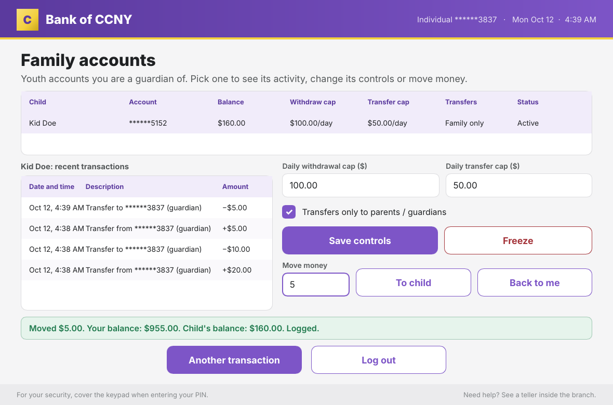

### 3.11 Cards from other banks

A card from another bank sees only **Withdraw cash**, **Fast Cash**,
**Balance inquiry** and **Daily limits**. Each withdrawal shows the ATM fee
(3% of the amount, $3.00 minimum, by default) before you confirm.

### 3.12 Cards in another currency

Bank of CCNY accounts are always in US dollars. A card from another bank may
be in another currency. The ATM pays only US dollar bills, so that card is
charged or credited at today's rate, plus an exchange fee (3% of the
amount, $3.00 minimum, by default). The confirmation shows every part. If the
currency has no current rate, or exchanges in it are paused, the ATM says so
and nothing is charged.

---

## 4. Teller Admin

### 4.1 Sign in and out

1. On the welcome screen, click **Teller Admin** (bottom right, next to
   "Staff:").
2. Type your **Staff ID** and **Password**, then click **Sign in**.
3. Pick a tab on the left. Click **Sign out** when done.

3 wrong passwords in a row pause sign-in for 60 seconds, doubling with each
further failure up to 15 minutes.

**The integrity check at sign-in.** Every Teller Admin sign-in runs the same
check as **Data integrity** ([4.9](#49-data-integrity)). If it passes, you see
nothing. If it fails, the ATM takes itself out of service at once:

- a red banner across the top says **INTEGRITY CHECK FAILED AT SIGN-IN: ATM
  OUT OF SERVICE** and the first thing that failed (accounts by their last 4
  digits only). **Data integrity** lists everything that failed;
- the start screen says "Out of service" and takes no cards, and a customer
  already signed in is stopped;
- the Cash Handler can't sign in, and one already signed in is stopped;
- Teller Admins keep working. The banner stays on every tab, and **Sign
  out** stays visible below the menu.

What to do:

1. Read what failed. Look at the **Audit log** and run **Data integrity**.
2. Escalate. Don't resume just to make the banner go away.
3. When it has been reviewed, click **Resume service** (on the banner or the
   Data integrity tab). The check runs again and its result is logged with
   your name. If it still fails, the ATM goes back in service anyway (you
   have reviewed it), the screen says the check still fails, and the next
   Teller Admin sign-in takes it out of service again.

The same banner, titled **ATM OUT OF SERVICE**, shows while a teller has
halted the ATM by hand ([4.9](#49-data-integrity)).

If `atm.db` itself was changed outside the ATM, sign-in (like everything else)
is refused with "TAMPERING DETECTED" instead. There is no banner and nothing
to resume: stop and escalate.

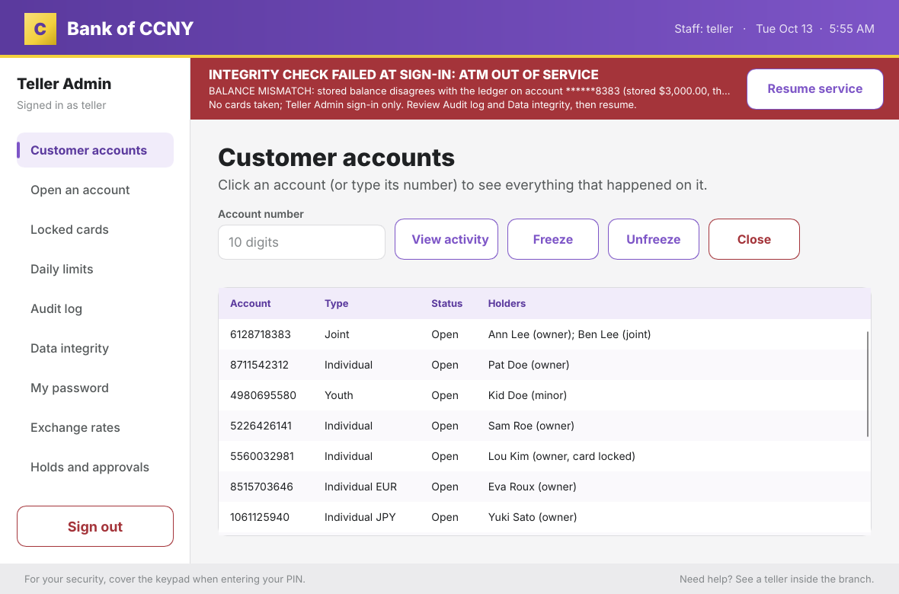

### 4.2 Open an account

Click **Open an account**, then pick what to open:

- **Individual** (18 or older): type the **Full name**, **Date of birth**
  (YYYY-MM-DD) and **Starting balance** (in US dollars). Turn the screen to the customer: they type their
  **PIN** and repeat it. Click **Open account**.
- **Joint holder** (a second adult on an existing account): type the
  **Existing account number** (in practice mode, **Choose** fills it in). The current holder, at the counter, types
  their own card number in **Current holder's card number** and their PIN in
  **Current holder's PIN, typed by them**. Type the new holder's name and
  date of birth; the new holder types their own PIN twice. Click **Add joint
  holder**. They get their own card and PIN.
- **Youth account** (under 18, US dollars): the parent types their own card
  number in **Parent's card number** and their PIN in **Parent's PIN, typed
  by them**. Type the **Child's full name**, the **Child's date of birth**
  and the starting balance; the child types a PIN twice. Click **Open youth
  account**. It starts at $100 a day cash, $50 a day transfers, and transfers
  only to family.
- **Add guardian**: type the **Youth account number** and the **New
  guardian's card number**. A current guardian types their own card number
  and PIN in **Current guardian's card number** and **Current guardian's
  PIN, typed by them**. Click **Add guardian**.
- **Other bank's card** (stands in for the card network): name, date of
  birth, the **balance at their bank** and the card's currency (one of 16,
  with flags). Click
  **Register card**.

The screen then shows the new **card number** (for signing in) and **account
number** (for receiving transfers). Give both to the customer. Yen and won
amounts are whole numbers.

A starting balance (or another bank's balance) can be at most the daily
deposit limit, $10,000 by default, counted in US dollars, and one teller's
starting balances can add up to at most $20,000 a day (no cash backs that
money). The customer deposits the rest at the ATM.

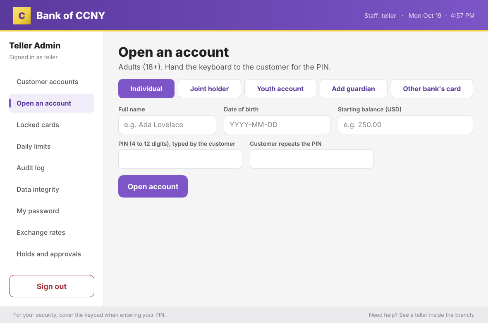

**The holder's card and PIN.** Joint holder, Youth account and Add guardian
decide who can use someone's money, so a teller can't do them alone. The
person who already has the account (the current holder, the parent, or a
current guardian) agrees by typing their own card number and PIN. The ATM
checks them:

- A wrong card number or PIN: "The holder's card number or PIN was not
  accepted. Ask them to type it again." Nothing is added. A wrong PIN counts
  toward that card's 3-try lock, just like at the ATM, and is logged.
- After the 3rd wrong PIN: "The holder's card is locked. Check their ID and
  unlock it under Locked cards first." ([4.4](#44-locked-cards))
- The card and PIN of someone who doesn't hold that account (or isn't a
  guardian of that youth account) are refused, even when the PIN is right.
- All PIN boxes are emptied after every try, so the holder and the new
  customer type their PINs again.

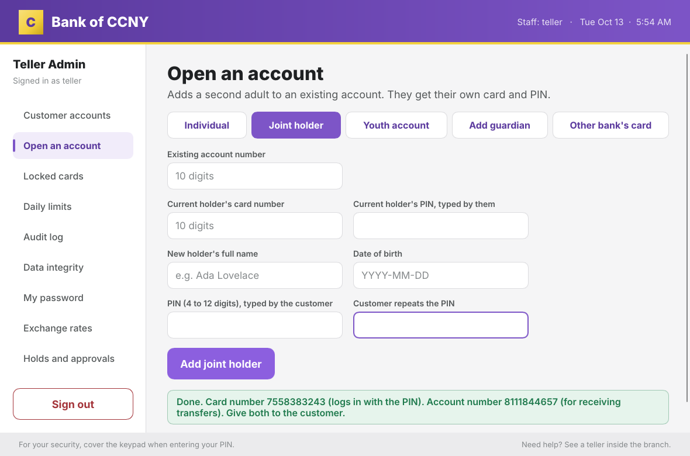

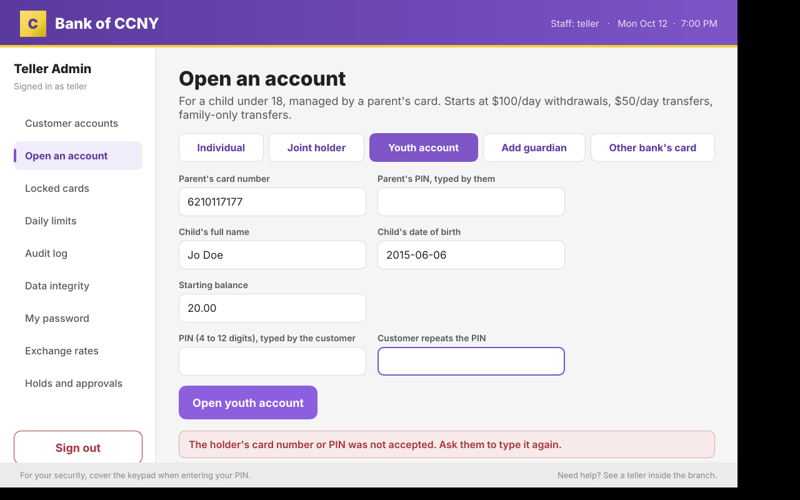

### 4.3 Customer accounts

**Customer accounts** lists every account with its type, status (Open,
FROZEN, Frozen by guardian, ON HOLD or Closed) and holders.

- Click an account (or type its **Account number** and click **View
  activity**) to see its full history with times. **All accounts** goes back.
- **Freeze** is the bank's freeze, for a lost or stolen card: the account's
  cards are refused at the ATM ("This account is frozen by the bank. Please
  see a teller inside the branch."), anyone signed in on it is stopped, it
  takes no transfers in, and its card can't agree to a joint holder, youth
  account or guardian at the counter. **Unfreeze** lifts the bank's freeze
  only.
- **Frozen by guardian** means a parent or guardian froze a youth account
  ([3.10](#310-family-accounts-parents-and-guardians)). Only they can lift
  it: your **Unfreeze** is refused. In the same way, a guardian can't lift
  the bank's freeze. If both froze it, the status shows FROZEN; after your
  Unfreeze it shows Frozen by guardian.
- **Close** needs a $0 balance; click **Close** again to confirm. A closed
  account's cards stop working and its number is never reused. The last open
  guardian of a youth account can't be closed.

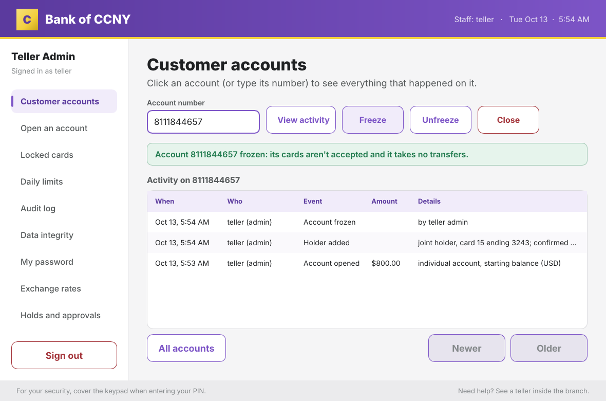

### 4.4 Locked cards

1. Click **Locked cards**. Each card locked by 3 wrong PINs is listed by its
   last 4 digits only ("ending 1234"), with the account's last 4, the
   holder's name and date of birth.
2. Check the customer's photo ID against them.
3. Ask for the card. Type the full number from it in **Card number, from the
   customer's card** and click **Unlock card**. The notice shows the card as
   `******1234`.

A card can be unlocked **once a day** (New York time). If it gets locked
again the same day, it stays locked until tomorrow. This stops anyone from
guessing a PIN 3 tries at a time between unlocks.

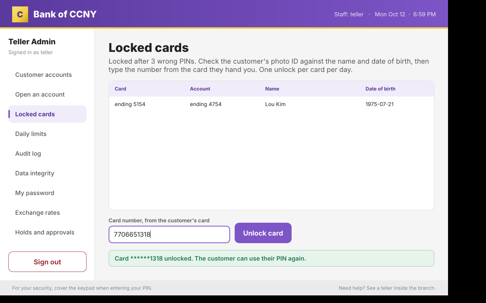

### 4.5 Daily limits (bank-wide)

Click **Daily limits**, change the **Withdrawal limit**, **Deposit limit** or
**Transfer limit**, and click **Save limits**. They apply to every account,
per day, New York time. Only changed values are saved, and each change is
logged. The most you can set is $5,000 for withdrawals, $50,000 for deposits
and $25,000 for transfers (the default limit plus the most a teller can
approve for one day).

### 4.6 Holds and approvals

**Accounts on hold.** Unusual activity puts a hold on the account: a 4th
withdrawal or 4th transfer within an hour, a 3rd new payee in 24 hours, $1,000
or more to a new payee, $500 sent out within an hour of $500 coming in, or one
move of $900 or more that takes 90% of the balance. The list
shows the holders, which rule matched and when.

1. Check the customer's photo ID and ask whether the activity was theirs.
2. Type the **Account number** and click **Release hold**.

**Approve a larger amount for today**, for a customer at the counter:

1. Type the **Account number**.
2. Pick **Withdrawal**, **Deposit** or **Transfer**.
3. Type the **Extra $** and click **Approve for today**.

The most you can add per account per day is $4,000 for withdrawals, $40,000
for deposits and $20,000 for transfers. Not for youth accounts or other banks'
cards.

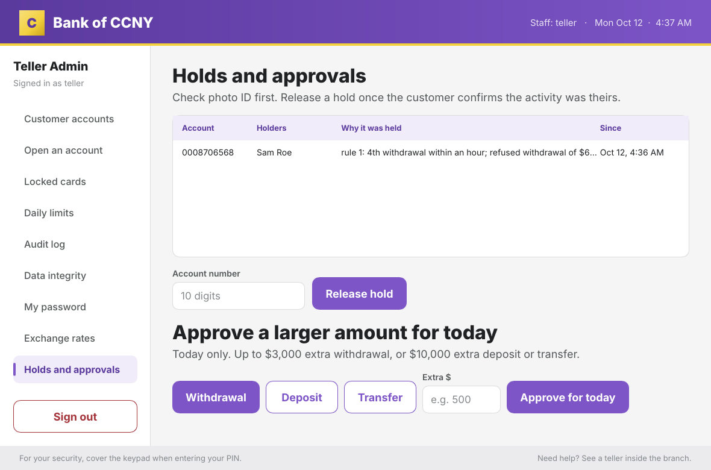

### 4.7 Exchange rates and fees

Each currency's rate is written as units per US dollar (for example EUR 0.86).

**Check today's rates (recommended; needs internet):**

1. Click **Exchange rates**, then **Check today's rates**.
2. Read the table. For each currency it shows the rate **Now**, **Today's
   feed**, what approving **Will set**, and a **Note**: the change in percent,
   "first rate", "no change", "outside the believable range: not used", or
   "big move: ...; will be paused".
3. Click **Approve these rates** to set them all, or **Cancel** to change
   nothing.

A currency that moved more than 5% in a day is set to the new rate but
**paused**: customers can't exchange it until you check the rate against
another source (for example a news site or your bank's treasury desk) and
click **Resume**. If the check fails (no connection, an untrusted
certificate, or a reply that isn't a proper feed), the message says which,
nothing changes, and the failure is logged.

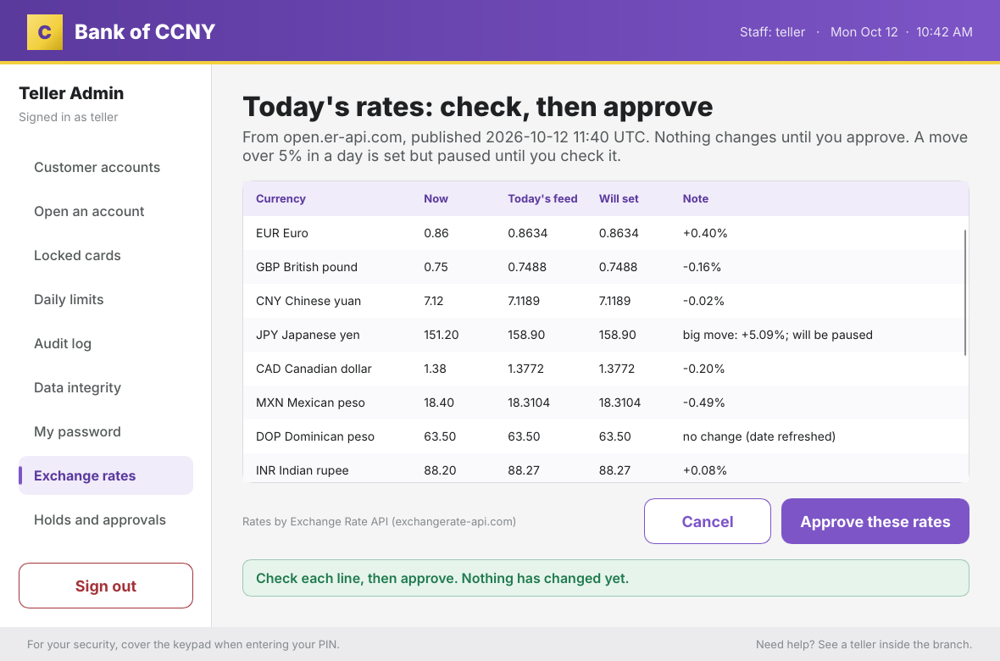
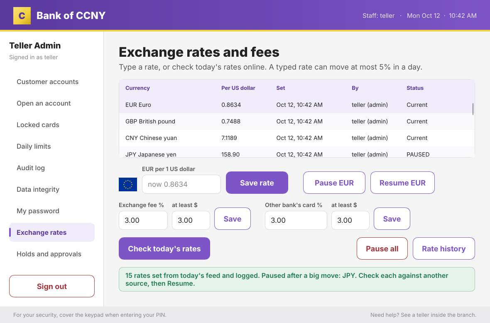

**Type a rate** (when the feed is unavailable): click a currency, type its
rate and click **Save rate**. It must be believable for that currency and
within 5% of every rate it had in the last 24 hours. For a bigger move, use
**Check today's rates**, or pause the currency.

**Pause and resume.** **Pause** stops exchanges in the selected currency at
once; **Resume** restarts them; **Pause all** stops every currency (for a
currency crash). Dollar cards keep working.

**Fees.** Set the **Exchange fee %** and its minimum (**at least $**), and the
**Other bank's card %** and its minimum, then click **Save** next to each.
Each fee can be 0-5% with a $0-$10 minimum.

**Rate history** lists every rate ever set, who set it and when. Nobody can
edit or delete it.

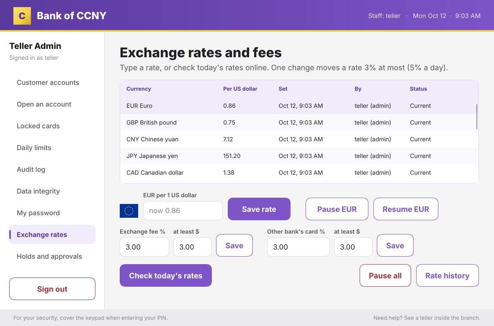

### 4.8 Audit log

**Audit log** shows every sign-in, failure, lockout, transaction and staff
action, 20 per page, newest first. Use **Newer**, **Older** and **Refresh**.
It also shows each **Service halted** and **Service resumed**, with who did
it (a failed check at sign-in shows as "system") and why.

### 4.9 Data integrity

Click **Data integrity**, then **Run check**. It re-checks the signed audit
log, recomputes every balance and the cash in the machine from it, checks the
signed limits, fees and exchange rates, and checks that the limits, exchange
rates and account freezes and closures match what the log says was done. Write down the check code it shows: if an older code ever
stops matching, the log was rebuilt. Run it before and after the demo. The
same check runs by itself at every Teller Admin sign-in
([4.1](#41-sign-in-and-out)).

A change made to `atm.db` by another program is refused at once, before
anything is done ("TAMPERING DETECTED"). So this check is for records that
don't add up although the file wasn't edited, for example a balance that
doesn't match its history. It then says **Problems found: stop using this
machine and escalate** and lists every problem, one per line, with accounts
named by their last 4 digits and both amounts (stored, and what the log
says).

- **Halt ATM** takes the ATM out of service by hand, for example while you
  look into something. No cards are taken, the Cash Handler can't sign in,
  the red banner appears, and the halt is logged with your name.
- **Resume service** (in place of Halt ATM while the ATM is out of service)
  puts it back after review. The check runs again: you see "Back in service.
  The integrity check passes." or, if it still fails, a red notice saying so.
  The resume and the check's result are logged.

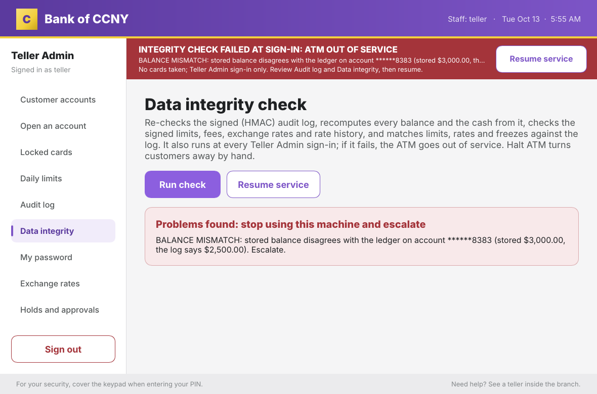

### 4.10 My password

Type your **Current password**, then the **New password** twice (12 to 128
characters), and click **Change password**.

---

## 5. Cash Handler

1. On the welcome screen, click **Cash Handler** (bottom right) and sign in
   with your Staff ID and password. While the ATM is out of service the
   Cash Handler can't sign in (the link is grayed out) until a Teller Admin
   resumes service.
2. **Cash inventory** shows the bills of each type, the total, the cash
   maximum ($100,000), the customer daily withdrawal limit, and warnings (low
   cash, a bill type under 20, over the maximum).
3. To **restock**: pick a bill, type the **Number of bills**, click
   **Restock**. You can fill up to the cash maximum.
4. To **remove** bills: pick a bill and a number, click **Remove**. You can
   only remove cash above the maximum (customer deposits can push it over, up
   to the $150,000 the machine physically holds).
5. **Reset to cash maximum** removes exactly the surplus, in the fewest bills.
6. **My password** works as for the Teller Admin.

---

## 6. Command-line version

The same ATM, in a terminal: `cargo run --release` (practice data:
`cargo run --release --features demo -- --demo`; for the integrity test see
[section 1](#integrity-test-test-builds-only)). It uses the same `atm.db`,
`atm.key` and `atm.anchor`, so accounts made in one version appear in the
other.

Menus are numbered: type the number and press Enter. `0` logs out. PINs,
passwords, and the card and transfer account numbers a customer types are
hidden as you type. The same rules and timeouts apply.

| Role | Options |
|---|---|
| Customer | 1 Balance · 2 Daily limits · 3 Withdraw (1 one bill type, 2 mostly one type, 3 fewest bills) · 4 Deposit · 5 Transfer (pick a recent account or type one) · 6 Recent transactions · 7 Family (guardians only; 5 and 6 move money to the child or back) · 8 Change PIN. Other banks' cards see 1-3 only. |
| Teller Admin | 1 Create customer · 2 Add joint holder · 3 Open youth account · 4 Add guardian · 5 Account audit log · 6 Set daily limits · 7 Locked cards / unlock · 8 Freeze or unfreeze · 9 Verify log + balances · 10 List accounts · 11 All recent events · 12 Close account · 13 Change my password · 14 Exchange rates and fees (set, pause, resume, history; built with `--features online-rates`, 8 checks today's rates and asks to approve) · 15 Register another bank's card · 16 Approve a larger amount for today · 17 Accounts on hold / release · 18 Halt the ATM / resume service |
| Cash Handler | 1 View cash · 2 Restock · 3 Remove bills above the maximum · 4 Reset to maximum · 5 Change my password |

The command line prints a receipt after every transaction (it doesn't ask)
and has no card to hand back.

**The holder's card and PIN (Teller options 2, 3, 4).** Each first asks for
the existing customer's card: "Current holder's card number" (2),
"Guardian's card number" (3), or, after the youth account number, "Current
guardian's card number" (4). Then it says "Hand the keypad to the current
holder to type their PIN." (or the guardian, or the current guardian) and
asks for their PIN, hidden. A wrong card number or PIN shows "Login failed."
(a wrong PIN counts toward that card's lock); a locked card shows "This card
is locked...".

**Locked cards (option 7)** lists each card as "card ending 1234 account
ending 5678" with the name and date of birth, then asks for the "Card
number, from the card the customer hands you".

**Out of service.** Right after sign-in, a red **INTEGRITY CHECK FAILED AT
SIGN-IN** and/or **ATM OUT OF SERVICE since ...** banner shows what failed,
then "Customers can't use the ATM. Review, then choose 18 to resume
service." Option 18 asks "Take the ATM out of service now? Customers will be
turned away. (y/n)", or, while it is out of service, "The ATM is out of
service. Resume service now that you've reviewed it? (y/n)". While out of
service the main menu shows "OUT OF SERVICE: no cards accepted; Teller Admin
sign-in only", a customer gets "This ATM is temporarily out of service.
Please use another ATM." before typing anything, and the Cash Handler gets
"The ATM is out of service. Only a Teller Admin can sign in until it is
resumed."

When a session ends (log out, or the 2-minute timeout noticed at the next
key), the command line clears the screen and its scrollback, so the next
person can't read or scroll back to the last one.

---

## 7. Messages you may see

| Message | What it means | What to do |
|---|---|---|
| "This card is locked. Please see a teller..." | 3 wrong PINs in a row (at the ATM or at the teller's counter), or 3 tries with a card number that doesn't exist | A teller unlocks it after checking ID, once a day at most ([4.4](#44-locked-cards)) |
| "This ATM is temporarily out of service. Please use another ATM." | A teller halted the ATM, or the integrity check at a Teller Admin sign-in failed. No cards are taken; signed-in customers are stopped too | Customers: use another ATM. Teller: review, then Resume service ([4.1](#41-sign-in-and-out)) |
| "The ATM is out of service. Only a Teller Admin can sign in until it is resumed." | The Cash Handler tried to sign in, or was signed in, while the ATM is out of service | Wait until a Teller Admin resumes service |
| "This account is frozen by the bank. Please see a teller inside the branch." | A teller froze the account (for example, a card reported stolen). Its cards are refused | See a teller with photo ID; only a teller unfreezes it ([4.3](#43-customer-accounts)) |
| "The holder's account is frozen by the bank, so their card can't confirm this." | Joint holder, Youth account or Add guardian: the current holder's account is frozen by the bank | Unfreeze it first if the holder is who they say they are |
| "Your session has ended. Please log in again." | Your card was locked or your account closed while you were signed in (or, on the command line, 2 minutes without input) | Insert your card again; see a teller if it is locked |
| "That would exceed the daily ... limit. Remaining today: ..." | Over the daily limit | Take less, or ask a teller to approve more for today ([4.6](#46-holds-and-approvals)) |
| "Not enough of that bill. Available for this amount: ..." | The machine is short of the bill you picked | Pick one of the bills listed, or Fewest bills |
| "This machine pays out at most 40 bills at a time..." | That amount in that bill would be over 40 bills | Pick bigger bills, or take the cash in two withdrawals |
| "For your protection, withdrawals and transfers on this account are paused..." | A hold after unusual activity | See a teller with photo ID ([4.6](#46-holds-and-approvals)) |
| "This account is frozen. Money cannot be taken out right now." | A parent or guardian froze this youth account (the card still works, but no money can leave) | The guardian unfreezes it under Family accounts; a teller can't lift a guardian's freeze |
| "Not allowed: the bank froze this account; please see a teller." | A guardian tried to unfreeze a youth account that the bank froze | See a teller |
| "Not allowed: this account was frozen by its guardian; only the guardian can unfreeze it." | A teller tried to unfreeze an account a guardian froze | The guardian unfreezes it under Family accounts ([3.10](#310-family-accounts-parents-and-guardians)) |
| "Insufficient funds." | The balance is too low | Take less |
| "Your session ended because of inactivity." | 2 minutes without a tap | Insert your card or sign in again |
| "Not allowed: a typed rate can move at most 5% in 24 hours..." | A typed rate too far from recent rates | Use Check today's rates, or pause the currency |
| "The holder's card number or PIN was not accepted. Ask them to type it again." (command line: "Login failed.") | Joint holder, Youth account or Add guardian: the card number or PIN the holder typed is wrong. A wrong PIN counts toward their card's lock | The holder types both again ([4.2](#42-open-an-account)) |
| "The holder's card is locked. Check their ID and unlock it under Locked cards first." (command line: "This card is locked...") | The holder's card is locked, perhaps by wrong PINs just now | Check their ID and unlock it ([4.4](#44-locked-cards)), then try again. If it was already unlocked today, it stays locked until tomorrow |
| "Not allowed: the card and PIN must be those of a current holder of this account." (or "... a current guardian of this account.") | The card and PIN were right, but that person doesn't hold that account, or isn't a guardian of that youth account | The account's own holder, or a current guardian, must agree |
| "Not allowed: this card was already unlocked today; it can be unlocked again tomorrow (New York time)." | One unlock per card per day | Unlock it tomorrow, after checking ID again |
| "Card not found." (when unlocking) | The number typed isn't a card's full number, for example only the last 4 digits | Type all 10 digits from the customer's card |
| "Not allowed: the daily withdrawal limit can be at most $5,000.00." (deposit $50,000.00, transfer $25,000.00) | A bank-wide limit above its ceiling | Set a lower limit, or approve more for one customer for today ([4.6](#46-holds-and-approvals)) |
| "Not allowed: a starting balance can't be more than the daily deposit limit; deposit the rest at the ATM." | A starting balance (or another bank's balance) over the daily deposit limit, counted in US dollars | Open the account with less; the customer deposits the rest |
| "Not allowed: today's starting balances would pass $20,000; open it with less and deposit the rest at the ATM." | One teller's starting balances today would add up to more than $20,000 (money with no cash behind it) | Open it with less, or with $0, and the customer deposits at the ATM |
| "BALANCE MISMATCH: ... on account ******1234 (stored ..., the log says ...)", "CASH MISMATCH: ...", "CHANGED WITH NO LOG ENTRY ...", "AUDIT LOG INTEGRITY FAILURE at entry ...", "TAMPERING DETECTED: the stored ... were changed outside the ATM.", or "2 PROBLEMS FOUND. 1) ... 2) ..." | Run check, or the red banner at sign-in: the records don't add up | Escalate. At sign-in the ATM goes out of service by itself ([4.1](#41-sign-in-and-out)); after Run check, click Halt ATM ([4.9](#49-data-integrity)) |
| "Back in service, but the integrity check still fails: ..." | A teller resumed service while the problem is still there. Logged | Escalate. The next Teller Admin sign-in takes the ATM out of service again |
| "Not allowed: the ATM is already out of service." / "Not allowed: the ATM is already in service." | Another teller (in another window) halted or resumed it first | Nothing: the banner shows the current state |
| "TAMPERING DETECTED: the database was changed outside the ATM. Nothing was done. Stop and escalate." | `atm.db` was changed by another program. Shown when the ATM starts (it doesn't open) or at the next action | Stop and escalate. Only the untouched, newest `atm.db` opens again |
| "DATABASE ROLLED BACK: this is an older copy of the bank's records. Nothing was done. Stop and escalate." | An older copy of `atm.db` was put back (for example, to undo a withdrawal or a lock) | Stop and escalate. Put the newest `atm.db` back |
| "Not allowed: the bank's database file is missing; restore it, or delete the key and anchor files to start a new bank on purpose." | `atm.db` is gone, but `atm.key` or `atm.anchor` is still there | Put `atm.db` back. Only to start a new, empty bank: delete all three files |
| "Not allowed: the key file is missing, so this database cannot be used." (or "the key file is damaged", "the key file does not belong to this database") | `atm.key` is gone, broken, or from another bank | Put the right `atm.key` back |
| "Not allowed: the anchor file is missing, so this database cannot be trusted." (or "... has been altered ...") | `atm.anchor` was deleted or edited | Put the right `atm.anchor` back |
| "Not allowed: this database was made by a different version; delete atm.db, atm.key and atm.anchor to start over." | Data from an older version of the ATM | Delete the three files (in practice mode, `atm-demo.*`) and start again |
| "Not allowed: this is a demo database with published passwords; it can't run as a real bank." | `atm.db` is a copy of practice data, whose passwords are public | Use the real bank's files. Practice data runs only with `--demo` |
| "Not allowed: this is a real bank's database, not demo data." | Practice mode found a real bank's data in `atm-demo.db` | Put the real data back where it belongs; delete `atm-demo.*` for fresh practice data |
| "System clock is behind the audit log. Fix the clock before using this ATM." | The computer's clock is earlier than the newest log entry | Fix the clock, then start again |
